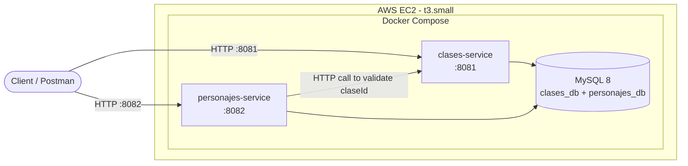

# RPG Microservices

Two independent Spring Boot REST APIs that manage RPG (Role-Playing Game) characters and classes, deployed as Docker containers on AWS EC2.

## Architecture



## Services

### clases-service (Port 8081)
Manages RPG character classes (Warrior, Mage, Cleric, etc.).

| Method | Endpoint | Description |
|--------|----------|-------------|
| GET | `/api/clases` | List all classes |
| GET | `/api/clases/{id}` | Get a class by ID |
| POST | `/api/clases` | Create a new class |
| PUT | `/api/clases/{id}` | Update a class |
| DELETE | `/api/clases/{id}` | Delete a class |
| GET | `/actuator/health` | Health check |

### personajes-service (Port 8082)
Manages RPG characters. Validates `claseId` against clases-service via HTTP.

| Method | Endpoint | Description |
|--------|----------|-------------|
| GET | `/api/personajes` | List all characters |
| GET | `/api/personajes/{id}` | Get a character by ID |
| GET | `/api/personajes/{id}/detalle` | Get character + full class info |
| POST | `/api/personajes` | Create a character |
| PUT | `/api/personajes/{id}` | Update a character |
| DELETE | `/api/personajes/{id}` | Delete a character |
| GET | `/actuator/health` | Health check |

## Tech Stack

- **Java 21** + **Spring Boot 4.1.2**
- **MySQL 8** (single container, two databases)
- **Docker** + **Docker Compose**
- **AWS EC2** (Amazon Linux 2023, t3.small)

## Run Locally

1. Make sure **Docker Desktop** is running.
2. Clone the repo:
   ```bash
   git clone https://github.com/Andybena2025/rpg-microservices.git
   cd rpg-microservices
   ```
3. Create a `.env` file (see `.env.example` for the template):
   ```bash
   cp .env.example .env
   # Edit .env and set your passwords
   ```
4. Start all services:
   ```bash
   docker compose up -d --build
   ```
5. Test:
   ```bash
   curl http://localhost:8081/api/clases
   curl http://localhost:8082/api/personajes
   ```

## AWS Deployment

The services are deployed on an EC2 instance with Docker Compose.

- **Public IP:** `18.214.99.108`
- **clases-service:** `http://18.214.99.108:8081/api/clases`
- **personajes-service:** `http://18.214.99.108:8082/api/personajes`

### Infrastructure
- **Instance:** t3.small (2 vCPU, 2 GB RAM), Amazon Linux 2023
- **Region:** us-east-1
- **Security Group:** SSH (port 22, restricted to admin IP), ports 8081 and 8082 open
- **Swap:** 2 GB swap file for memory headroom

## Postman Collection

Import `rpg-microservices.postman_collection.json` into Postman. It includes all endpoints and error cases for both services. Update the `baseUrlClases` and `baseUrlPersonajes` variables to point to the EC2 IP when testing the cloud deployment.

## Author

Andres Benavides — CUE University
